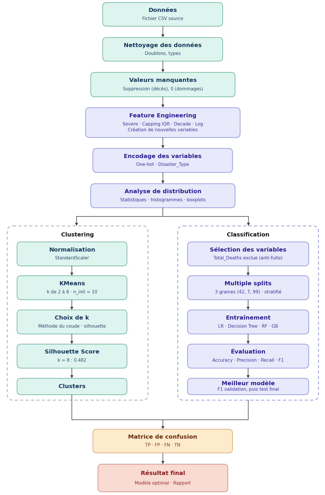
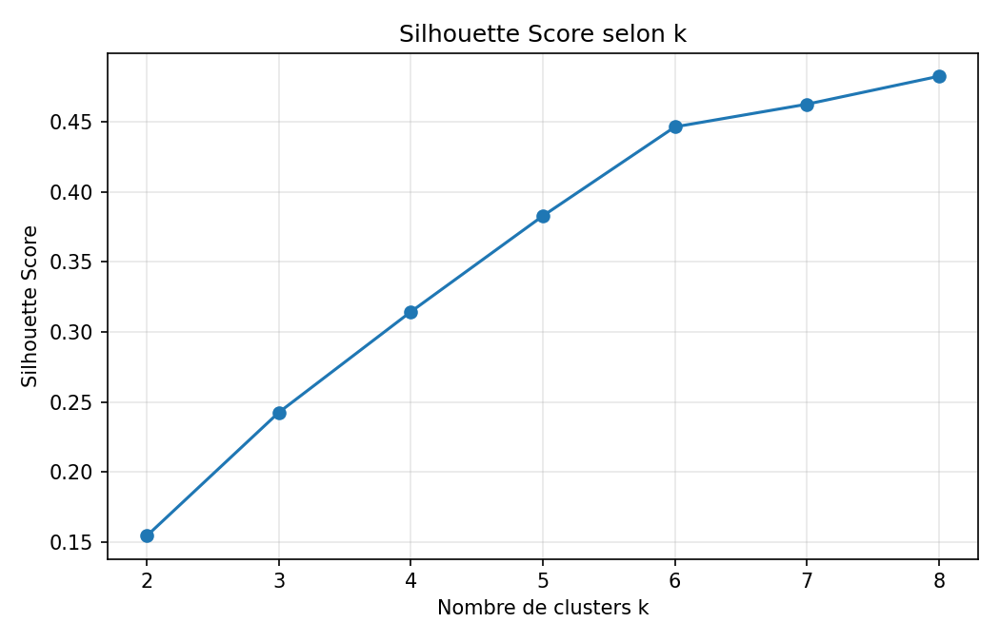
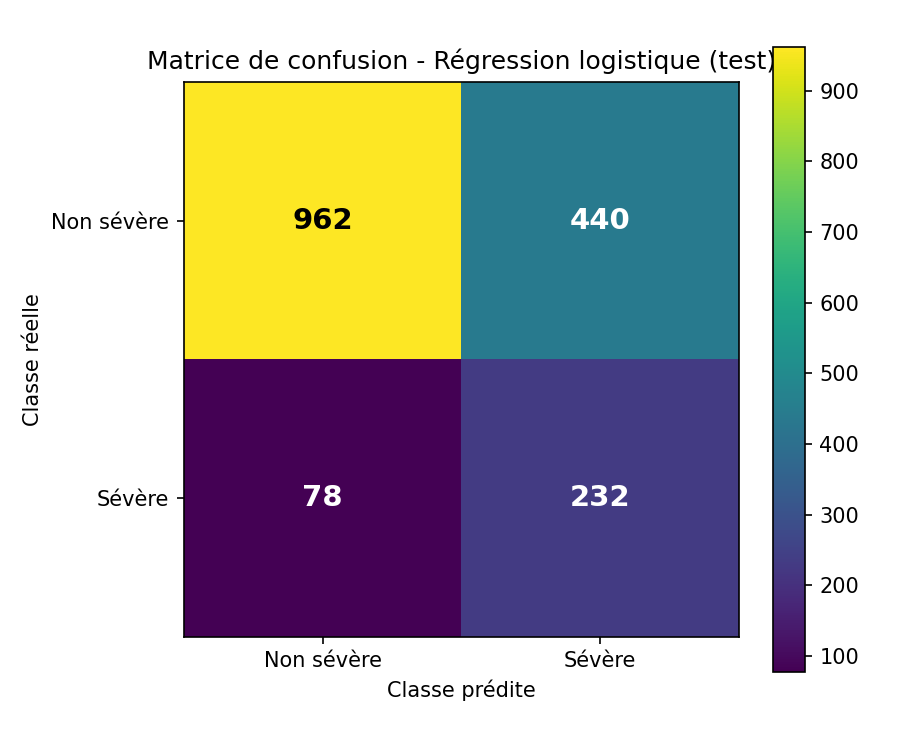

<div align="center">

# 🌍 Analyse des catastrophes naturelles
### Clustering (KMeans) et classification de la sévérité


*Projet de Data Mining — Année universitaire 2025/2026*

</div>

---

## 📑 Sommaire

1. [Présentation du projet](#-présentation-du-projet)
2. [Résultats clés](#-résultats-clés)
3. [Jeu de données](#-jeu-de-données)
4. [Méthodologie](#-méthodologie)
5. [Résultats détaillés](#-résultats-détaillés)
6. [Limites et pistes d'amélioration](#-limites-et-pistes-damélioration)
7. [Structure du dépôt](#-structure-du-dépôt)
8. [Installation et exécution](#-installation-et-exécution)
9. [Auteur](#-auteur)

---

## 🎯 Présentation du projet

Les catastrophes naturelles ont des impacts majeurs sur les populations et les économies. Les données disponibles pour les décrire sont nombreuses, mais hétérogènes et souvent incomplètes, ce qui rend leur exploitation délicate.

Ce projet répond à la question suivante : **comment exploiter ces données pour regrouper les catastrophes similaires et prédire leur niveau de sévérité ?**

| Axe | Type d'apprentissage | Objectif | Méthode |
|---|---|---|---|
| **Clustering** | Non supervisé | Regrouper les catastrophes aux profils similaires | KMeans (k de 2 à 8) |
| **Classification** | Supervisé | Prédire si une catastrophe est *sévère* | Logistic Regression, Decision Tree, Random Forest, Gradient Boosting |

> **Définition de la cible** : une catastrophe est **sévère** (`Severe = 1`) lorsque le nombre total de décès est **supérieur à 100**, sinon `Severe = 0`.

---

## 🏆 Résultats clés

| Indicateur | Valeur |
|---|---|
| Observations exploitables | **11 413** catastrophes (1900 – 2021) |
| Catastrophes sévères | **2 071** (≈ 18,1 %) → classes déséquilibrées |
| Meilleur nombre de clusters (silhouette) | **k = 8** — silhouette = **0,482** |
| Meilleur modèle (F1 moyen en validation) | **Logistic Regression** — F1 = **0,450** |
| Rappel de la classe « sévère » (test) | **≈ 0,75** (232 / 310 catastrophes sévères détectées) |

Le modèle retenu privilégie le **rappel** : dans un contexte de gestion des risques, il est préférable de détecter un maximum de catastrophes sévères, quitte à générer des fausses alertes.

---

## 📊 Jeu de données

- **Fichier** : [`natural_disasters.csv`](natural_disasters.csv)
- **Taille brute** : 16 126 lignes × 45 colonnes
- **Période couverte** : 1900 – 2021
- **Types de catastrophes** : 15 (principalement *Flood*, *Storm*, *Earthquake*, *Epidemic*, *Landslide*, *Drought*)

Colonnes utilisées dans ce projet :

| Colonne | Description |
|---|---|
| `Year` | Année de l'événement |
| `Disaster Type` | Type de catastrophe (encodé en variables indicatrices) |
| `Total Deaths` | Nombre total de décès (sert à construire la cible `Severe`) |
| `Total Damages ('000 US$)` | Dommages économiques en milliers de dollars (renommée `Damage_Thousands_USD`) |

---

## 🔬 Méthodologie

Le pipeline complet est résumé dans le schéma ci-dessous.

<div align="center">
  
</div>

### 1. Préparation des données

| Étape | Traitement | Effet |
|---|---|---|
| Nettoyage des noms | Suppression des espaces et caractères spéciaux | Colonnes exploitables dans le code |
| Doublons et types | `drop_duplicates()`, conversion de `Year` en entier | Aucune ligne supprimée à cette étape |
| Valeurs manquantes — décès | Suppression des lignes sans `Total_Deaths` | **4 713 lignes supprimées** (la cible en dépend) |
| Valeurs manquantes — dommages | Remplacement par `0` | Hypothèse de travail (voir [limites](#-limites-et-pistes-damélioration)) |
| Valeurs aberrantes | **Capping IQR** (`Q1 − 1,5·IQR`, `Q3 + 1,5·IQR`) | Maximum ramené de 3 700 000 à 148,5, sans perte de lignes |

### 2. Feature engineering

| Variable | Définition |
|---|---|
| `Severe` | Cible binaire : `1` si décès > 100, sinon `0` (calculée **avant** le capping) |
| `Total_Deaths_Capped` | Décès après capping IQR (analyse et clustering uniquement) |
| `Decade` | Décennie de l'événement |
| `Damage_Log` | `log1p(Damage_Thousands_USD)` pour atténuer l'effet des grandes valeurs |
| `Disaster_Type_*` | Encodage one-hot (`get_dummies`, `drop_first=True`) |

### 3. Clustering — KMeans

- **Variables (15)** : `Total_Deaths_Capped`, `Damage_Log`, `Year` + 12 variables de type de catastrophe
- **Normalisation** : `StandardScaler`
- **Choix de k** : méthode du coude (inertie) et **silhouette score** pour k ∈ [2, 8], `n_init=10`, `random_state=42`

### 4. Classification — protocole anti-fuite et multi-splits

- **Variables (14)** : `Damage_Log`, `Year` + 12 variables de type de catastrophe
- **`Total_Deaths` exclue** des variables explicatives pour éviter la fuite de la cible (*target leakage*)
- **Découpage stratifié** : 70 % entraînement / 15 % validation / 15 % test
- **3 graines** (`42`, `7`, `99`) pour mesurer la stabilité des résultats
- **Normalisation sans fuite** : le `StandardScaler` est ajusté sur l'entraînement uniquement
- **Gestion du déséquilibre** : `class_weight="balanced"` (LR, Decision Tree, Random Forest)
- **Early stopping** pour le Gradient Boosting (`n_iter_no_change=5`)
- **Sélection du modèle** sur le **F1-score moyen de validation** ; le jeu de test n'est utilisé qu'**une seule fois**, à la fin
- **Entraînement final** : train + validation réunis, évaluation sur le test

---

## 📈 Résultats détaillés

### Clustering

| k | Inertie | Silhouette |
|:-:|--:|--:|
| 2 | 154 656 | 0,154 |
| 3 | 139 888 | 0,242 |
| 4 | 126 423 | 0,314 |
| 5 | 113 311 | 0,383 |
| 6 | 100 438 | 0,446 |
| 7 | 88 844 | 0,463 |
| **8** | **77 225** | **0,482** |

<div align="center">
  
</div>

Répartition des 11 413 catastrophes dans les 8 clusters :

| Cluster | 0 | 1 | 2 | 3 | 4 | 5 | 6 | 7 |
|---|--:|--:|--:|--:|--:|--:|--:|--:|
| **Effectif** | 3 512 | 4 080 | 1 164 | 1 266 | 69 | 741 | 91 | 490 |

### Classification — comparaison sur 3 splits (validation)

| Modèle | Accuracy | Precision | Recall | **F1 moyen** | F1 écart-type |
|---|--:|--:|--:|--:|--:|
| **Logistic Regression** | 0,693 | 0,333 | **0,694** | **0,450** | 0,008 |
| Decision Tree | 0,721 | 0,330 | 0,522 | 0,404 | 0,003 |
| Random Forest | 0,753 | 0,358 | 0,459 | 0,402 | 0,005 |
| Gradient Boosting (early stopping) | 0,830 | 0,589 | 0,203 | 0,301 | 0,037 |

**Lecture des résultats**

- Le **Gradient Boosting** affiche la meilleure accuracy mais rate près de 80 % des catastrophes sévères (rappel ≈ 0,20) : l'accuracy est trompeuse sur des classes déséquilibrées.
- La **Logistic Regression** offre le meilleur compromis précision / rappel et reste très stable d'un split à l'autre.

### Évaluation finale — jeu de test (1 712 observations)

<div align="center">
  
</div>

| | Prédit non sévère | Prédit sévère |
|---|:-:|:-:|
| **Réel non sévère** | 962 (VN) | 440 (FP) |
| **Réel sévère** | 78 (FN) | 232 (VP) |

| Métrique | Valeur |
|---|--:|
| Accuracy | 0,697 |
| Precision (sévère) | 0,345 |
| Recall (sévère) | 0,748 |
| F1-score (sévère) | 0,473 |

> Les métriques ci-dessus sont calculées à partir de la matrice de confusion du jeu de test.

---

## ⚠️ Limites et pistes d'amélioration

**Limites**

- **Précision faible (≈ 0,35)** : environ deux alertes « sévère » sur trois sont de fausses alarmes (440 faux positifs).
- **Suppression de 29 % des lignes** (4 713) faute de nombre de décès : un biais de sélection est possible.
- **Dommages manquants remplacés par 0** : une valeur manquante ne signifie pas toujours « aucun dommage ».
- **Variables explicatives limitées** : seuls les dommages, l'année et le type de catastrophe sont utilisés, car `Total_Deaths` est exclue pour éviter la fuite de la cible.
- **k optimal en bordure de plage** : le silhouette score croît jusqu'à k = 8, la borne supérieure testée ; un k plus élevé pourrait encore améliorer le score.

**Pistes d'amélioration**

- Enrichir les données : pays, région, magnitude, population exposée, indicateurs socio-économiques.
- Tester des modèles plus avancés (XGBoost, LightGBM) avec optimisation des hyperparamètres (`GridSearchCV`).
- Ajuster le **seuil de décision** pour arbitrer précision et rappel, ou utiliser des techniques de rééquilibrage (SMOTE).
- Explorer d'autres algorithmes de clustering (DBSCAN, clustering hiérarchique) et élargir la plage de k.

---

## 📂 Structure du dépôt

```text
.
├── README.md                                          # Documentation du projet
├── requirements.txt                                   # Dépendances Python
├── natural_disasters.csv                              # Jeu de données source
├── projet_data_mining_catastrophes_naturelles.ipynb   # Notebook complet (code + analyses)
├── presentation.pdf                                   # Présentation (PDF)
├── presentation.pptx                                  # Présentation (PowerPoint)
└── files/                                             # Visuels d'interprétation
    ├── flowchart.png                                  #   Schéma de la méthodologie
    ├── silhouette.png                                 #   Silhouette score selon k
    └── confusion_matrix.png                           #   Matrice de confusion (test)
```

---

## 🚀 Installation et exécution

**Prérequis** : Python 3.9 ou supérieur.

```bash
# 1. Cloner le dépôt
git clone https://github.com/<votre-utilisateur>/<nom-du-depot>.git
cd <nom-du-depot>

# 2. Créer un environnement virtuel (recommandé)
python -m venv .venv
source .venv/bin/activate        # Windows : .venv\Scripts\activate

# 3. Installer les dépendances
pip install -r requirements.txt

# 4. Lancer le notebook
jupyter notebook projet_data_mining_catastrophes_naturelles.ipynb
```

> Le notebook lit `natural_disasters.csv` dans son propre dossier : gardez les deux fichiers côte à côte.
> Les résultats sont reproductibles grâce aux graines fixées (`random_state` = 42, 7 et 99).

---

## 👩‍💻 Auteur

**Sarra Askri** — Projet de Data Mining, année universitaire 2025/2026

---

<div align="center">
<sub>Si ce projet vous est utile, n'hésitez pas à lui laisser une ⭐</sub>
</div>
